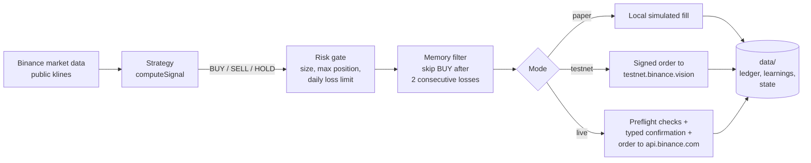

# BTC Trading Bot

A research-first trading bot for Binance spot, written in TypeScript / Node.js.

It pulls real BTCUSDT market data, runs it through a **signal → risk → memory → execution** pipeline, and logs a plain-English reason for every decision. It runs in three modes: local paper simulation, Binance Spot Testnet (fake money), and a deliberately hard-to-start live mode with a small cap on order size.

The interesting part isn't the strategy. It's the process: every strategy idea was backtested net of fees, checked for statistical significance and compared against buy-and-hold, and most of them were rejected. The execution code was then hardened against the failures that actually cost money: lost order responses, state that disagrees with the wallet, and fees taken out of the coin you bought.

> **Not financial advice.** This is a learning project. Backtests aren't predictions, and nothing here has been shown to beat simply holding BTC. Live mode trades real funds. It's off by default and capped, but use it at your own risk.

---

## What this project demonstrates

- **Honest backtesting.** Results are reported net of a 0.22% round-trip cost, against a buy-and-hold benchmark, with a t-statistic and a minimum trade count before any conclusion is drawn.
- **Statistical discipline.** Strategies are tested across timeframes, parameters, assets and separate market eras, so a lucky parameter isn't mistaken for an edge. The research log records the mistakes made along the way and how each one was corrected.
- **Defence-in-depth safety.** Credential-name traps, an endpoint allowlist, a permanent block on withdrawals and transfers, a host lock on signed requests, a hard cap on order size, a typed per-order confirmation and a file-based kill switch.
- **Failure handling.** A write-ahead order journal, recovery of a lost response by client order ID, reads that are retried while orders never are, atomic state writes, and a refusal to trade when the state file is missing or corrupt.
- **Tests you can run.** 103 offline checks across three suites, with no network or API keys needed, run in CI on every push.

---

## Research results

All figures come from this project's own backtests on Binance BTCUSDT data. The full methodology, tables and corrections are in [`docs/RESEARCH_LOG.md`](docs/RESEARCH_LOG.md).

| Strategy | Tested on | Verdict |
|---|---|---|
| 9/21 MA crossover | 5m candles | **Rejected.** No edge. BTC was range-bound and trades timed out near breakeven. |
| RSI(14) mean reversion | 5m, 15m, 1h, 4h and 1d; 343 trades over ~2.6 years on 1h | **Rejected.** Gross edge 0.00% ± 0.034% per trade, net −0.22% per trade, t = −6.41. The data rules out any edge large enough to cover costs. |
| Trend following (price vs N-day MA) | 1d candles, 7 lookbacks × 4 eras (2017–2026), 5 assets | **Kept, as a risk tool.** It cut drawdown versus buy-and-hold in 28 of 28 parameter-era combinations. It beat buy-and-hold on return in only 18 of 28, which isn't significant (p ≈ 0.09). |
| Donchian breakout | 1d candles | **Implemented and logic-tested** (no look-ahead, live signal matches backtest). Not yet evaluated for performance. |

**Bottom line:** trend following on daily candles is the default because it's the only configuration the evidence supports. It's a way to reduce drawdown. It doesn't reliably make more money than holding.

---

## How it works



The **same** signal, risk, memory and recovery code runs in testnet and live. The only difference between the two is the mode, so live mode doesn't have its own special code path that testnet never exercised.

### Modes

| Mode | `TRADING_MODE` | Keys needed | What it touches |
|---|---|---|---|
| Paper | `paper` (default) | none | Public market data only. Fills are simulated locally. |
| Testnet | `testnet` | `BINANCE_TESTNET_API_KEY` / `_SECRET` | Binance Spot Testnet: real API, fake money. |
| Live | `live` | `BINANCE_LIVE_API_KEY` / `_SECRET` + `LIVE_TRADING_ACKNOWLEDGED` | Your real Binance account. Runs one cycle per invocation, with no unattended loop. |

### Safety layers

1. **Poisoned credential names.** If `BINANCE_API_KEY`, `API_KEY` or a similar name is set, the bot refuses to start in *every* mode. Each mode reads its own distinct variable names, so a real key pasted into the obvious variable can't start anything.
2. **Endpoint allowlist.** Only the specific Binance endpoints the bot needs are reachable. Withdrawal, transfer, margin, lending and staking endpoints are blocked in every mode, with no flag to unblock them.
3. **Signed-request host lock.** Each authenticated request is checked against the expected host right before it's sent.
4. **Live preflight.** Every live run first checks that the API key has withdrawals and internal transfers **disabled**, that the account can trade and that clock drift is under 2 seconds. Otherwise it refuses to go on. It also warns if the key isn't limited to an IP address.
5. **Notional cap.** Orders are capped at `MAX_ORDER_NOTIONAL` (default 25 USDT). A hard ceiling of 250 USDT lives in the source, so raising it takes a code change rather than a typo in the shell.
6. **Typed confirmation.** To place a live order you have to type the exact side, quantity and symbol. Pressing Enter or `y` won't do it.
7. **Kill switch.** If the file `data/HALT` exists, every live command stops.
8. **No guessing about state.** If the live state file is missing or corrupt, the bot refuses to trade instead of assuming it holds nothing. `npm run state:init` records the position deliberately, using the balance the exchange reports.

### Failure handling

- **Lost order responses.** A client order ID is written to disk *before* the order is sent. If the response never arrives, the outcome is treated as *unknown*, not *failed*, and the bot asks the exchange what happened before it places anything else.
- **Retries.** Reads are retried with exponential backoff and jitter, and the bot honours `Retry-After`. Order requests are **never** retried automatically, because resending after a timeout is how one position becomes two.
- **Fee-aware sizing.** BUYs are recorded net of any fee taken in BTC. SELLs never ask for more than the wallet actually holds. This bug was caught on the first real order: the fee had come out of the BTC received, so the planned exit would have been rejected.
- **Atomic state.** State is saved with a temp file → `fsync` → rename sequence, so a power cut can't leave an empty file in its place.

---

## Quick start (paper mode, no keys)

Requires **Node.js 20.12+**.

```bash
git clone https://github.com/IvorJr-Lefawane/Trading-bot.git
cd Trading-bot
npm install
npm test              # 103 offline checks — no network, no keys
npm run scan          # one paper decision cycle on live BTCUSDT data
npm run backtest      # strategy vs buy-and-hold, net of costs
```

To change settings, copy `.env.example` to `.env`. The `.env` file is git-ignored.

---

## Commands

| Command | What it does | Places orders? |
|---|---|---|
| `npm test` | Runs all three offline test suites | no |
| `npm run typecheck` | TypeScript strict-mode check | no |
| `npm run scan` | One paper decision cycle on real candles | simulated |
| `npm run backtest` | Signal-exit backtest against buy-and-hold | no |
| `npm run replay:raw` | Fixed stop/target replay on real candles | no |
| `npm run replay:windows` | Same strategy across several separate windows, scored against readiness checks | no |
| `npm run sweep` | Strategy across 5m / 15m / 1h / 4h / 1d | no |
| `npm run robustness` | Tries to break a result: other lookbacks and other assets | no |
| `npm run periods` | Lookbacks × non-overlapping market eras | no |
| `npm run replay:memory` | What the memory filter would decide on the latest setup | no |
| `npm run memory:reset` | Clears the ledger and learnings | no |
| `npm run broker:check` | Testnet: connection, clock, balances, symbol rules | no |
| `npm run broker:preview` | Testnet: builds the current order and has Binance validate it | no |
| `npm run broker:testorder` | Testnet: round trip at the exchange minimum to measure real cost | testnet |
| `npm run broker:live` | Testnet: strategy on a timer, with reconciliation | testnet |
| `npm run env:doctor` | Explains which mode and settings are actually loaded (never prints secrets) | no |
| `npm run live:check` | Live: read-only account and key-permission check | no |
| `npm run state:init` | Live: records the bot's position from the balance you verified | no |
| `npm run live:trade` | Live: one cycle, with a typed confirmation per order | **real** |

Strategy and parameters can be overridden per run with `STRATEGY`, `INTERVAL`, `TREND_LOOKBACK` and `SYMBOL`. Available strategies are `trend_following` (the default), `donchian_breakout`, `rsi_mean_reversion` and `ma_crossover`.

---

## Testing

```bash
npm test
```

| Suite | Checks | Covers |
|---|---|---|
| `guardrail:test` | 50 | Refused credentials and modes, endpoint allowlist, blocked withdrawals and transfers in all three modes, live preconditions, kill switch |
| `failure:test` | 42 | Retry classification, clock-drift resync, lost order responses and the three recovery outcomes, client ID format, state corruption, fee-net sizing (including 20,000 random cases) |
| `donchian:test` | 11 | No look-ahead, live signal matches backtest events |

The guardrail suite runs the real entry points in child processes with unsafe environments and checks that each one is refused. The failure suite uses a scripted fake exchange. Neither needs network access, so CI runs both on every push (see [`.github/workflows/ci.yml`](.github/workflows/ci.yml)).

---

## Project structure

```
src/
  strategy.ts          signals: trend following, Donchian, RSI, MA crossover
  risk.ts              risk gate every signal passes through
  adaptiveFilter.ts    memory filter (skip after repeated losses)
  memory.ts            ledger.csv + learnings.md
  bot.ts / index.ts    paper scan cycle and default config
  market.ts            public market data (real candles only)
  execution.ts         paper fills
  binanceClient.ts     signed Binance client: retries, recovery, sizing, fee handling
  guardrails.ts        mode, credential, endpoint and notional rules
  livePreflight.ts     checks run at the start of every live run
  liveState.ts         atomic, strict state persistence
  brokerLive.ts        testnet loop
  brokerLiveReal.ts    live single cycle
  backtest*.ts, signalBacktest.ts, replay*.ts, sweep.ts, robustness.ts, periods.ts
                       research tooling
  *Test.ts             offline test suites
docs/
  RESEARCH_LOG.md      full research history, results and corrections
  COST_ANALYSIS.md     fee, slippage and dust analysis (planned work)
ma_crossover_strategy.pine   TradingView version of the original MA strategy
```

---

## Known limitations

- **No proven return edge.** The default strategy reduces drawdown. Its return advantage over buy-and-hold isn't statistically significant.
- **One asset class and survivorship bias.** The research covers about 9 years of crypto, and BTC survived and rose a lot over that period.
- **Backtests fill at the close at the modelled cost.** They don't model real slippage, outages or API failures.
- **No exchange-side stop order.** In live mode the bot only exits when you run it.
- **Dust at small sizes.** At a 25 USDT order size, the rounding left over on each round trip costs about 3%, which is far more than the fees. See [`docs/COST_ANALYSIS.md`](docs/COST_ANALYSIS.md). A high-frequency strategy can't work at this account size.
- **Known gaps in failure handling.** Exchange downtime longer than the retry budget isn't handled. Neither is a partial fill followed by a crash, or clock drift too large for `recvWindow` on every attempt.

---

## How this was built

This started from Miles High Club's *Paper Trading Bot Prompts*, a six-prompt guide for building a paper-trading baseline with Claude. I developed it well beyond that: strategy research and rejection, testnet and live adapters, failure handling and the test suites. I built it with AI assistance (Claude). The design decisions, testing and live runs were my own.

## License

[MIT](LICENSE)
